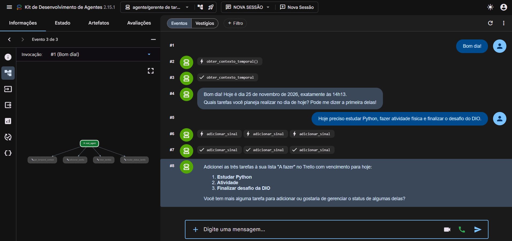
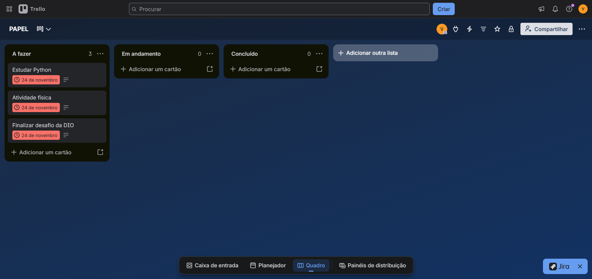
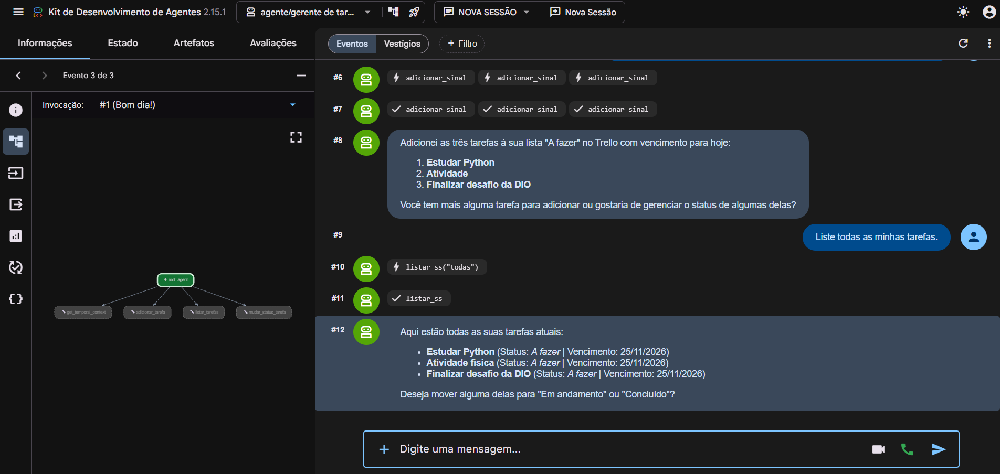
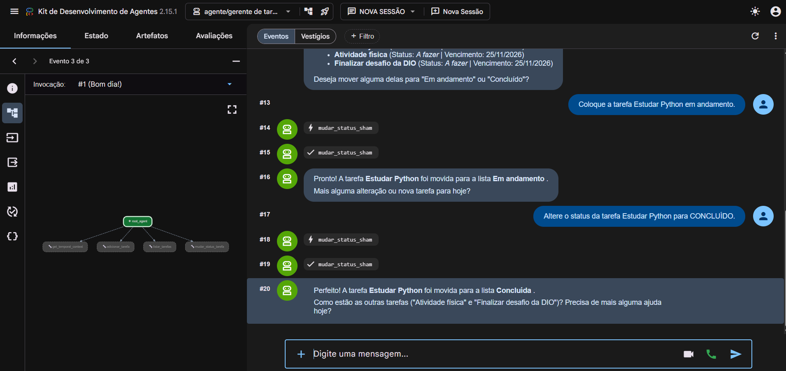
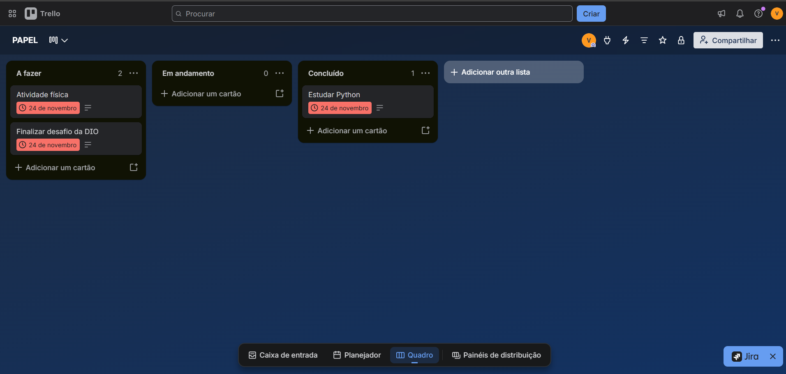
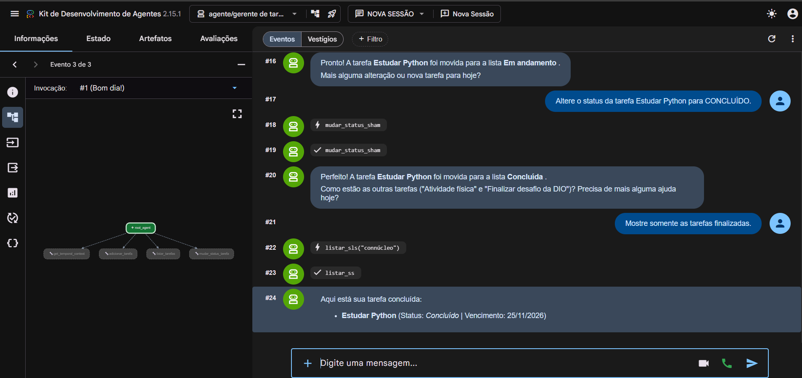
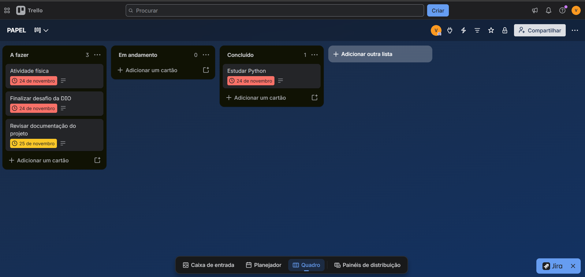

# Trello AI Agent - Agente Inteligente de Gerenciamento de Tarefas

Assistente virtual inteligente desenvolvido em Python para gerenciamento de tarefas no **Trello**, orquestrado pelo **Google ADK (Agent Development Kit)** e alimentado pelo modelo **Google Gemini**. Projeto estruturado para o desafio prático da **Digital Innovation One (DIO)**.

---

## 🎯 Apresentação e Objetivo

O **Trello AI Agent** permite organizar fluxos de trabalho e rotinas diárias no Trello utilizando linguagem natural. O agente é capaz de:
- Compreender saudações e iniciar a interação diária contextualizada com a data e horário locais.
- Criar cartões no Trello com título, descrição e prazo de vencimento.
- Listar todas as tarefas ativas ou filtrar dinamicamente por status.
- Mover cartões entre listas (*A fazer*, *Em andamento* e *Concluído*) através de instruções conversacionais fluidas, tolerando variações linguísticas, acentuações e sinônimos.

---

## 💻 Tecnologias Utilizadas

- **Python 3.14.3**: Linguagem base do projeto.
- **Google ADK (`google-adk`)**: Framework moderno para orquestração, definição de agentes orientados a código e *function calling*.
- **Google Gemini (`gemini-3.5-flash-lite`)**: Modelo de linguagem ultrarrápido, otimizado para raciocínio, ferramentas e plano gratuito.
- **Trello REST API (`py-trello`)**: Biblioteca Python para integração com as APIs de quadros, listas e cartões do Trello.
- **python-dotenv**: Gerenciamento seguro de variáveis de ambiente.
- **pytest**: Framework para testes unitários e de integração automatizados.

---

## 🏛️ Arquitetura do Agente e Fluxo de Funcionamento

```
+--------------------+        Linguagem Natural        +-----------------------------+
|      Usuário       | <=============================> |      Google ADK Web UI      |
+--------------------+                                 +-----------------------------+
                                                                     |
                                                                     v
                                                       +-----------------------------+
                                                       |         root_agent          |
                                                       |   (gemini-3.5-flash-lite)   |
                                                       +-----------------------------+
                                                                     |
                                             +-----------------------+-----------------------+
                                             |           Function Calling (Tools)            |
                                             v                       v                       v
                              +--------------------+   +--------------------+   +--------------------+
                              | get_temporal_ctx   |   |  adicionar_tarefa  |   | mudar_status_tarefa|
                              | (America/Sao_Paulo)|   |   (Fuso ↔ UTC)     |   |   (normalizer.py)  |
                              +--------------------+   +--------------------+   +--------------------+
                                                                     |
                                                                     v
                                                       +-----------------------------+
                                                       |    TrelloClient (REST API)  |
                                                       |     Quadro: DIO (Listas)    |
                                                       +-----------------------------+
```

### Fluxo Operacional:
1. **Início da Sessão**: O usuário envia uma saudação (ex.: `"Bom dia"`). O agente invoca `get_temporal_context` para obter o momento exato no fuso `America/Sao_Paulo` e responde saudando com a data atual e solicitando as tarefas do dia.
2. **Criação com Tratamento Temporal**: À medida que o usuário lista tarefas, a ferramenta `adicionar_tarefa` converte a data para o horário padrão local (23h59) e a converte para UTC antes de enviar ao Trello.
3. **Movimentação e Filtros com Resiliência Linguística**: Quando o usuário pede para listar ou alterar tarefas usando termos como *"fazendo"*, *"finalizado"*, *"concluído"* ou *"pendente"*, o módulo `normalizer.py` mapeia para as listas canônicas do quadro sem falhas de acento ou sintaxe.

---

## 🛠️ Descrição das Ferramentas Python

As ferramentas disponibilizadas para o modelo no arquivo `agenttaskmanager/agent.py` são:

| Ferramenta | Parâmetros | Descrição |
|---|---|---|
| `get_temporal_context` | Nenhum | Retorna data e hora formatadas no fuso horário `America/Sao_Paulo`. Utilizada para situar temporalmente a conversa diária. |
| `adicionar_tarefa` | `nome_da_task`, `descricao_da_task`, `due_date` | Cria um cartão na lista *A fazer*. Se `due_date` não possuir horário, adota 23h59 local e envia em ISO 8601 UTC. |
| `listar_tarefas` | `status` (padrão: `"todas"`) | Recupera as tarefas do quadro. Permite filtrar por status (*A fazer*, *Em andamento*, *Concluído*) e converte a data de vencimento UTC para o formato local `DD/MM/AAAA HH:MM`. |
| `mudar_status_tarefa` | `nome_da_task`, `novo_status` | Localiza o cartão pelo nome em qualquer lista e move-o para a lista de destino correspondente ao novo status normalizado. |

---

## 📁 Estrutura de Diretórios

```
trello-ai-agent/
│
├── agenttaskmanager/              # Pacote principal do agente
│   ├── __init__.py                # Inicializador do pacote e exportações
│   ├── agent.py                   # Definição do root_agent e tools
│   ├── date_utils.py              # Utilitários de data e fusos (America/Sao_Paulo ↔ UTC)
│   └── normalizer.py              # Normalizador nativo de termos e sinônimos
│
├── evidencias/                    # Evidências visuais dos testes reais
│   ├── 01-criacao-tarefas.png
│   ├── 02-cartoes-criados.png
│   ├── 03-listagem-tarefas.png
│   ├── 04-movimentacao.png
│   ├── 05-status-concluido.png
│   ├── 06-filtro-status.png
│   └── 07-correcao-data.png
│
├── tests/                         # Suíte de testes automatizados
│   ├── __init__.py
│   ├── test_date_utils.py         # Testes de data e conversão UTC
│   ├── test_normalizer.py         # Testes de variações, sinônimos e acentos
│   └── test_tools.py              # Testes unitários das ferramentas com Mocks
│
├── .env.exemplo                   # Template de variáveis de ambiente
├── .gitignore                     # Proteção de credenciais, venv, caches e bancos
├── pytest.ini                     # Configuração do pytest
├── requirements.txt               # Dependências do projeto
└── README.md                      # Documentação completa do projeto
```

---

## 🌟 Melhoria 1: Normalização de Status, Acentuação e Sinônimos

A melhoria implementada no módulo `agenttaskmanager/normalizer.py` utiliza exclusivamente recursos nativos da biblioteca padrão do Python (`unicodedata`, `re`):

- **Normalização NFKD**: Decompõe caracteres acentuados (ex.: `concluído` → `concluido`), permitindo casar grafias com e sem acento.
- **Insensibilidade a maiúsculas e pontuações**: Converte para caixa baixa e remove pontuações mantendo a legibilidade.
- **Dicionário Semântico de Sinônimos**:
  - **A fazer**: `a fazer`, `pendente`, `pendentes`, `to do`, `todo`.
  - **Em andamento**: `em andamento`, `em progresso`, `progresso`, `fazendo`, `doing`, `in progress`.
  - **Concluído**: `concluido`, `concluído`, `finalizado`, `feito`, `pronto`, `done`, `terminado`.
  - **Todas**: `todas`, `todos`, `all`, `*`.

Essa função é utilizada tanto para interpretar o comando de voz/texto do usuário quanto para identificar as listas correspondentes no quadro do Trello de maneira resiliente.

---

## 🕒 Melhoria 2: Correção de Datas e Fusos Horários (America/Sao_Paulo ↔ UTC)

A melhoria implementada no módulo `agenttaskmanager/date_utils.py` corrige a divergência de datas exibidas no Trello:

- **Causa da divergência**: O Trello interpreta datas simples sem fuso (ex.: `2026-11-25`) como meia-noite em UTC (`2026-11-25T00:00:00.000Z`). Como o Brasil opera em UTC-3, isso equivalia às 21h00 do dia 24/11/2026, exibindo a data do dia anterior nos cartões.
- **Tratamento no envio (`converter_para_utc`)**:
  - Quando o usuário não informa horário, o agente adota **23h59:00 no fuso `America/Sao_Paulo`**.
  - O horário resultante (`2026-11-25 23:59:00 -03:00`) é convertido para UTC (`2026-11-26T02:59:00.000Z`) antes de ser enviado à API do Trello. No navegador do usuário, o cartão é renderizado na data correta: **25 de novembro**.
- **Tratamento na listagem (`converter_de_utc_para_local`)**:
  - Na ferramenta `listar_tarefas`, o timestamp UTC retornado pelo Trello é convertido de volta para o horário local e formatado amigavelmente (`DD/MM/AAAA HH:MM`).

---

## 🧪 Resultado dos 17 Testes Automatizados

A suíte completa de testes automatizados roda localmente sem depender de credenciais reais ou conexão com o Trello, utilizando objetos simulados (*mocks*):

```powershell
.\.venv\Scripts\python -m pytest -v
```

Resultado obtido:

```text
============================= test session starts =============================
platform win32 -- Python 3.14.3, pytest-9.2.0, pluggy-1.7.0
rootdir: C:\Users\valdi\Documents\trello-ai-agent
configfile: pytest.ini
testpaths: tests
plugins: anyio-4.16.0
collected 17 items

tests/test_date_utils.py::test_converter_para_utc_vazio PASSED           [  5%]
tests/test_date_utils.py::test_converter_para_utc_sem_horario_padrao_23h59 PASSED [ 11%]
tests/test_date_utils.py::test_converter_para_utc_com_horario PASSED     [ 17%]
tests/test_date_utils.py::test_converter_de_utc_para_local PASSED        [ 23%]
tests/test_normalizer.py::test_normalizar_a_fazer_variacoes PASSED       [ 29%]
tests/test_normalizer.py::test_normalizar_em_andamento_variacoes PASSED  [ 35%]
tests/test_normalizer.py::test_normalizar_concluido_variacoes PASSED     [ 41%]
tests/test_normalizer.py::test_normalizar_todas PASSED                   [ 47%]
tests/test_normalizer.py::test_normalizar_status_com_espacos_e_caracteres_especiais PASSED [ 52%]
tests/test_normalizer.py::test_normalizar_status_invalido PASSED         [ 58%]
tests/test_tools.py::test_temporal_context_timezone PASSED               [ 64%]
tests/test_tools.py::test_adicionar_tarefa PASSED                        [ 70%]
tests/test_tools.py::test_listar_tarefas_todas PASSED                    [ 76%]
tests/test_tools.py::test_listar_tarefas_filtro_status PASSED            [ 82%]
tests/test_tools.py::test_mudar_status_tarefa_sucesso PASSED             [ 88%]
tests/test_tools.py::test_mudar_status_tarefa_invalido PASSED            [ 94%]
tests/test_tools.py::test_mudar_status_card_nao_encontrado PASSED        [100%]

============================= 17 passed in 1.24s ==============================
```

---

## 📸 Evidências dos Testes Reais

Os testes operacionais foram realizados com integração ativa entre o Google ADK Web UI, o modelo Gemini e o quadro no Trello:

### 1. Inicialização e Criação de Tarefas
O agente saúda informando data e horário de Brasília e cria três cartões simultaneamente:


### 2. Cartões Inseridos no Quadro do Trello
Visualização dos três cartões adicionados na lista *A fazer*:


### 3. Listagem Geral de Tarefas
O agente consulta e exibe todas as tarefas cadastradas:


### 4. Movimentação de Cartões via Linguagem Natural
O usuário solicita mover tarefas para *"em andamento"* e depois para *"CONCLUÍDO"*:


### 5. Quadro do Trello com Status Atualizado
Confirmação visual no Trello com o cartão movido para a lista *Concluído*:


### 6. Filtro por Sinônimo ("finalizadas")
O agente interpreta o sinônimo *"finalizadas"* e filtra exclusivamente a lista de concluídos:


### 7. Validação da Correção de Data
Novo cartão criado com vencimento corretamente alinhado ao dia corrente no Trello:


---

## ⚠️ Limitação Conhecida da Plataforma

Durante os testes reais, foi identificada uma limitação externa na camada gratuita da API do Gemini:
- **Instabilidade Ocasional (HTTP 503 - Service Unavailable)**: Em períodos de alta demanda global, a API pode retornar indisponibilidade temporária.
- **Impacto**: O erro pode ocorrer mesmo após a ferramenta Python ter executado sua ação com êxito no Trello (por exemplo, o cartão já foi criado ou movido, mas o modelo falha na geração do texto de resposta).
- **Ação Recomendada**: Aguardar alguns segundos e reenviar a instrução, ou consultar a listagem de tarefas para confirmar o estado do quadro.

---

## 🚀 Instalação e Execução

### 1. Clonar o Repositório e Criar Ambiente Virtual

```powershell
# Criação do ambiente virtual
python -m venv .venv

# Ativação no Windows (PowerShell)
.\.venv\Scripts\Activate.ps1
```

### 2. Instalar Dependências

```powershell
pip install -r requirements.txt
```

### 3. Configurar Credenciais

Copie o modelo `.env.exemplo` para `.env` e preencha suas chaves:

```powershell
cp .env.exemplo .env
```

Edite o `.env`:
```env
GOOGLE_API_KEY=sua_chave_do_google_ai_studio
GOOGLE_GENAI_USE_VERTEXAI=0
GEMINI_MODEL=gemini-3.5-flash-lite
TRELLO_API_KEY=sua_api_key_trello
TRELLO_API_SECRET=seu_api_secret_trello
TRELLO_TOKEN=seu_token_trello
TRELLO_BOARD_NAME=DIO
```

### 4. Executar os Testes Automatizados

```powershell
pytest -v
```

### 5. Iniciar o Agente na Web UI

```powershell
adk web agenttaskmanager
```

Acesse o painel no navegador: **`http://127.0.0.1:8000`**.

Para executar em modo terminal:
```powershell
adk run agenttaskmanager
```

---

## 📜 Referência e Créditos

- **Finalidade**: Implementação educacional desenvolvida para atender ao desafio prático da Digital Innovation One (DIO).
- **Repositório de Referência**: [Digital Innovation One (DIO) - agent-carbon-footprint](https://github.com/digitalinnovationone/agent-carbon-footprint) (pasta `agents/agent04`).
- **Instrutor Responsável**: Henrique Eduardo Souza (DIO).
- Todos os direitos autorais, créditos pedagógicos e de concepção do agente original pertencem à DIO e ao instrutor responsável.
